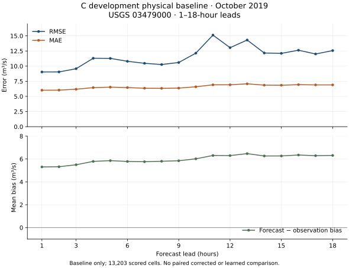
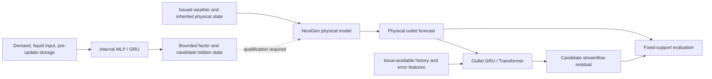

# HYDRA · NextGen neural correction

Research software for correcting hydrologic forecasts at two levels: **outlet streamflow residuals** and **selected internal process interfaces**. This is the current neural-correction project in Mitchel Carson's HYDRA research, published as a small, inspectable source snapshot.

The public package includes original C/Python MLP and GRU inference kernels, forecast-availability and evaluation guards, and the retained MLX GRU–Transformer outlet architecture. The default demo is deterministic, offline and dependency-free.

**Status — 12 October 2026:** engineering research, not an operational forecasting system. The current internal-correction continuation has zero learned fits. A composed physical baseline on October 2019 C development data has now been scored against USGS and its small evaluation products are included below. It has no paired learned-correction result; original native-run and physics/state limitations remain explicit. Earlier outlet studies are separate and are not ranked against this C window.

## Try it

Python 3.10+:

```sh
python3 -m venv .venv
. .venv/bin/activate
python -m pip install .
hydra-correctors
python -m unittest discover -s tests -p test_evaluation.py -v
python -m unittest discover -s tests -p test_demo.py -v
```

Installation may fetch the packaging tool; the core has no runtime dependencies. The demo makes no network requests and reads no research files. It shows a canonical model-artifact round trip, independent candidate GRU branches, rejection of an unavailable observation and fixed-support scoring on three invented forecast targets. Its coefficients are analytic and untrained; its scores illustrate arithmetic only. [Expected demo output](examples/demo-output.json).

With a C99 compiler on macOS/Linux, check the original native inference kernels against the independent Python reference:

```sh
python scripts/check_native.py
```

This optional check builds only the small standalone kernel in a temporary directory. It checks reset-after GRU equations, C/Python numerical agreement, neutral factors, immutable branch state, strict serialization, invalid inputs, overflow and atomic error output. It does not build or run NextGen.

The [optional outlet check](docs/REPRODUCING.md#optional-outlet-model) exercises the retained GRU–Transformer on one synthetic example using MLX CPU inference. It needs additional packages and performs no training.

## Saved research evaluation

The [C physical-baseline bundle](results/c_physical_baseline_2019_10/README.md) retains **744 issues, 13,392 raw forecast cells and 13,203 scored cells** at USGS 03479000 over October 2019, with 1–18-hour leads. Pooled RMSE is **11.69 m³/s**, MAE **6.59 m³/s**, and forecast-minus-observation bias **+5.97 m³/s**. This is development-data physical-baseline evidence, not a corrected-versus-baseline or trained-neural improvement claim.



Metrics CSV/JSON, report, figure, evaluation code/config and checksums are versioned. Bulk forecasts/observations and weights remain external. Recompute the saved aggregate arithmetic with `python scripts/check_baseline.py`; no private data or model execution is needed. Read the [scientific limitations](results/c_physical_baseline_2019_10/README.md#limits-on-interpretation) before interpreting the scores.

## What is here

| Component | Implementation | Public evidence and limits |
| --- | --- | --- |
| Internal MLP / GRU | [Python reference](src/hydra_correctors/kernels.py), [C99 kernels](native/kernels.c), [explicit ABI](native/kernels.h) | Untrained inference arithmetic; 81 / 3,489 parameters; factor in `[0.5, 2]`; no physical update or optimizer |
| Outlet correction | [Retained MLX architectures](src/hydra_correctors/outlet/models_mlx.py) | GRU–Transformer predicts 18 normalized residuals from 168 hours of history and issued forecast/error features; no fitted weights included |
| Evaluation contracts | [Timing, scaling, lineage and paired scoring](src/hydra_correctors/evaluation.py) | Rejects future observations, overlapping stack support and incomplete prediction keys; metadata validation cannot authenticate real data vintages |
| Reproduction | [Checks and environment](docs/REPRODUCING.md), [validation record](docs/VALIDATION.md) | Small generated fixtures and two outlet forward calls; no model training, data download or physical reforecast |



The dotted connection is a research integration boundary. A bounded factor alone does not prove water balance, energy balance, native compatibility or hydrologic skill. Candidate recurrent state must be committed only after a successful physical update. This public package does not implement that coupled transaction.

## Research boundaries

- [Working/publication map](docs/PROJECT_MAP.md) and [runbook](docs/RUNBOOK.md) define the authoritative portable source and results home; historical runtime copies remain frozen evidence.
- [Scientific status and limitations](docs/STATUS.md) distinguishes implemented code, generated tests, historical experiments and proposed coupled studies.
- [Architecture and numerical contracts](docs/ARCHITECTURE.md) explains internal versus outlet correction.
- [Source provenance](docs/SOURCE_PROVENANCE.json) identifies each extracted file by exact hash and lists every packaging change.
- [Publication boundary and future update contract](docs/PUBLICATION_CONTRACT.md) governs reviewed checkpoint updates.

Three separate projects have separate responsibilities:

1. [Original HYDRA thesis — NWM streamflow correction](https://github.com/Mitchel34/hydra-nwm-streamflow-correction): the earlier GRU–Transformer thesis work.
2. [NextGen reforecast software](https://github.com/Mitchel34/nextgen-reforecast-software): generation-software planning and provenance; its public runtime status is documented there.
3. **This repository:** current NextGen outlet and internal neural-correction research.

The historical [NextGen_Hydra acquisition workflow](https://github.com/Mitchel34/NextGen_Hydra) is a separate earlier project. None of these links implies that the present showcase is a complete reforecast generator or the original thesis reproduction.

## License and attribution

No blanket open-source license has been selected for original HYDRA code. Public visibility is not an open-source license grant; see [LICENSE_STATUS.md](LICENSE_STATUS.md). Retained Mamba/SSD portions preserve their Apache-2.0 and MIT notices and license texts; see [THIRD_PARTY_NOTICES.md](THIRD_PARTY_NOTICES.md). This is independent research, not an official NOAA, CIROH, or MLX distribution.
